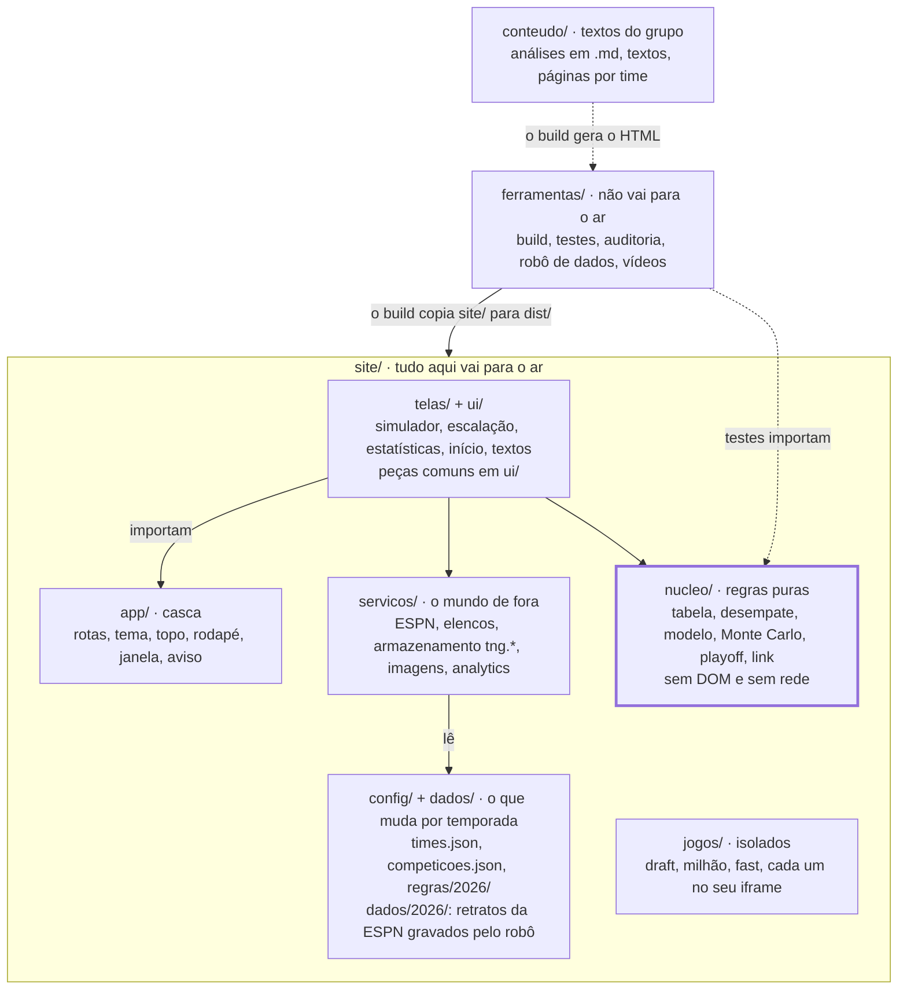

# Tapa na Gaveta: arquitetura e plano

15/11/2026 · Matheus Garcia de Farias · decisão registrada em [decisoes/0001](decisoes/0001-organizacao-do-projeto.md)

A proposta: manter o site sem build e sem framework, mas organizá-lo em camadas claras (núcleo, serviços,
telas, configuração), com módulos ES nativos, times e temporadas como dados e testes em todo PR. A
migração vai em fases, sem quebrar links compartilhados nem dados salvos no aparelho.

Este arquivo é o plano de referência. Ao terminar uma fase, marque-a na tabela de [situação](#situação-das-fases)
e registre qualquer desvio numa nota nova em `docs/decisoes/`.

## Para onde o projeto cresce

O site já tem 7 ligas, 3 jogos, análises e vídeos. Os próximos passos naturais pedem uma estrutura que
aceite mais de cada coisa sem que tudo passe pelo mesmo arquivo.

| Eixo | O que vem | O que a arquitetura precisa |
| --- | --- | --- |
| Temporadas | Brasileirão 2027, com times que sobem e descem | Trocar de ano só com dados e configuração, sem mexer em código |
| Formatos | Copa do Brasil (mata-mata), Libertadores (grupos + mata-mata) | Núcleo com formatos plugáveis (já desenhado em [ELIMINATORIAS.md](ELIMINATORIAS.md)) |
| Conteúdo | Mais análises, páginas por time, vídeos do TikTok | Conteúdo separado do código, gerado no build |
| Jogos | Novos jogos e atualizações dos apps | Cada jogo isolado, com recursos comuns compartilhados |
| Idiomas | Inglês e espanhol (decisão em aberto) | Textos fora do código das telas |
| Pessoas | Mais gente mexendo ao mesmo tempo | Arquivos pequenos, donos por área e testes em todo PR |
| Usuários | Talvez login, bolão, ranking | Espaço para um serviço próprio, só quando houver motivo |

## O que trava o crescimento hoje

A base é boa: núcleo puro e testado, dados em três camadas, jogos isolados, publicação automática. Os
gargalos são de organização, não de tecnologia. (Retrato de 15/11/2026.)

| Problema | Onde | Por que pesa quando crescer |
| --- | --- | --- |
| Arquivo gigante | `app/abas/simulador.js`: 1.866 linhas, 128 KB, ~80 funções (jogos, tabela, chances, revelação, imagens, cenários, playoff) | Quase toda mudança passa por ele: conflito de merge e efeito colateral |
| Núcleo misturado | `shared/simulador-core.js`: 895 linhas com liga, modelo, Monte Carlo, playoff, link, "o que precisa" e migração de versões antigas | Formatos novos (mata-mata, grupos) entram no mesmo arquivo |
| Times no código | Cores, nomes curtos, siglas e gênero em `simulador.js`; os 20 clubes do rodapé em `app.js` | Em 2027 sobem e descem 4 times: é preciso caçar listas pelo código |
| Ano no código | "2026" aparece em 21 arquivos de código e ferramentas, além dos nomes dos JSON | A virada de temporada vira uma busca e troca arriscada |
| Globais | Tudo conversa por `window.TNG`, `window.TNGCore` e scripts injetados | Sem lista de dependências: difícil saber o que quebra ao mexer |
| Testes só na `main` | Os testes rodavam no workflow de publicação, não nos PRs | O erro aparecia depois do merge, e a publicação travava (resolvido na Fase 0) |
| Duas pastas de ferramentas | `tools/` e `ferramentas/` | Ninguém sabe onde pôr o script novo |
| Recursos duplicados | 14 fontes idênticas em `shared/fonts` e `jogos/draft/shared/fonts` | Mais peso e duas cópias para atualizar |
| Docs desatualizados | `docs/PLANO.md` dizia k = 32 e peso 1,2; o código usa k = 48 e 2,0 desde 11/11 | Decisões sem registro confiável (resolvido na Fase 0) |
| Erros invisíveis | Em produção, `reportError` não enviava nada | Ninguém sabia quando o site quebrava no celular de alguém (resolvido na Fase 0) |

## Princípios

- **Editar e apertar F5 continua sendo o ciclo inteiro.** Nada de bundler, framework ou etapa de compilação para desenvolver.
- **Regras puras ficam longe da tela.** Tudo que é conta (tabela, modelo, simulação) roda no Node e é testado sem navegador.
- **O que muda por temporada é dado, não código.** Times, cores, regras e zonas moram em JSON.
- **Uma pasta, uma responsabilidade.** Quem abre o repositório sabe onde cada coisa mora e onde pôr a nova.
- **Contratos não quebram.** As chaves `tng.*`, os links de cenário e os endereços públicos (`/simulador/flamengo/`, `#/jogos/milhao`) continuam valendo.
- **Migração aos poucos.** Cada fase é um PR que deixa o site no ar e os testes verdes.

## As camadas



As dependências só descem: telas usam a casca, os serviços e o núcleo; os serviços leem configuração e
dados; o núcleo recebe tudo como parâmetro e não importa ninguém. É isso que deixa o núcleo testável no
Node e reaproveitável no Worker, nas páginas geradas e nos vídeos.

## Estrutura de pastas

A regra de ouro: **tudo dentro de `site/` vai para o ar; nada fora dele vai.** O `serve.py` passa a servir
`site/` como raiz, então `localhost:8780/` continua igual.

```text
tapa-na-gaveta/
├─ site/                      o que vai para o ar (o build copia daqui)
│  ├─ index.html
│  ├─ nucleo/                 regras puras: sem DOM, sem rede (navegador, Worker e Node)
│  │  ├─ liga/                tabela, desempate, zonas, rodadas
│  │  ├─ mata-mata/           playoff (depois: chave, grupos)
│  │  ├─ modelo/              Poisson + Dixon-Coles, parâmetros calibrados
│  │  ├─ simulacao/           Monte Carlo, "o que o meu time precisa", worker
│  │  └─ cenario/             link de cenário, migração das versões antigas
│  ├─ servicos/               falam com o mundo: espn, elencos, armazenamento,
│  │                          compartilhar, vídeo, gif, analytics
│  ├─ app/                    casca: roteador, tema, topo, rodapé, janela, aviso
│  ├─ ui/                     peças reaproveitadas: escudo, barra de chances,
│  │                          cartão de jogo, linha da tabela
│  ├─ telas/                  uma pasta por aba
│  │  ├─ simulador/           index, estado, jogos, tabela, chances, precisa,
│  │  │                       revelacao, cenarios, imagens, playoff
│  │  ├─ escalacao/  estatisticas/  inicio/  textos/
│  ├─ estilos/                tokens.css (cores, fontes), base.css, um .css por tela
│  ├─ config/                 o que muda por temporada, sem código
│  │  ├─ competicoes.json
│  │  ├─ times.json           nome curto, sigla, cores, gênero, escudo, ids externos
│  │  └─ regras/2026/         seriea.json, serieb.json, europa-20.json...
│  ├─ dados/2026/             gerado pelo robô, nunca editado à mão
│  ├─ jogos/                  draft/  milhao/  fast/  (cada um isolado no iframe)
│  └─ recursos/               fontes/, midia/, vendor/ (uma cópia só, para site e jogos)
├─ conteudo/                  analises/*.md, textos/*.html, paginas.json
├─ ferramentas/               une tools/ e ferramentas/
│  ├─ build/  dados/  testes/  auditoria/  video/
├─ docs/                      PLANO.md, ARQUITETURA.md, decisoes/ (uma nota por decisão), refino/
├─ package.json               só scripts: dev, test, build, auditar
└─ .github/workflows/         checar.yml (todo PR), publicar.yml, atualizar-dados.yml
```

O que muda para quem trabalha no projeto:

- **Uma regra nova de desempate** vai em `site/nucleo/liga/` e ganha teste em `ferramentas/testes/`.
- **Um time que sobe** é uma linha em `config/times.json` e um escudo em `recursos/midia/escudos/`.
- **Uma liga nova** é uma entrada em `competicoes.json` e um arquivo de regras.
- **Uma análise** continua sendo um `.md` em `conteudo/analises/`.

## Decisões técnicas

| Decisão | Por quê | Custo ou risco |
| --- | --- | --- |
| **Módulos ES nativos** (`import`/`export`, `<script type="module">`, Worker `type: 'module'`) no lugar de IIFE + `window.*` | Dependências explícitas, arquivos pequenos sem globais, o mesmo arquivo roda no navegador e no Node. Continua sem build | Safari 15+ (2021). O build precisa gerar um *import map* com a versão, para nunca misturar arquivo velho com novo (hoje isso é o `?v=`). Conferir a prévia do Artifact (`tools/artifact.js`) |
| **`config/times.json`** como catálogo único de clubes | Uma fonte para cores, nome curto, sigla, artigo ("a Chapecoense"), escudo e ids da ESPN e do Você Escala | Migrar as listas de `simulador.js` e `app.js` uma vez |
| **Temporada como pasta** (`regras/2026/`, `dados/2026/`), ano atual em `competicoes.json` | Virar para 2027 vira uma mudança de dados; 2026 continua acessível para histórico | Os caminhos mudam no build e no robô de dados |
| **`package.json` só com scripts** (`npm run dev`, `npm test`, `npm run build`) e `.nvmrc` com Node 22 | Um jeito único de rodar tudo, igual no Mac de cada um e no GitHub Actions | Nenhum: zero dependências para o site |
| **Testes com `node:test`** (nativo do Node) | Um arquivo de teste por módulo do núcleo, saída padrão, roda em paralelo | Reescrever o `testar-core.js` aos poucos; as 222 conferências viram a base |
| **Workflow `checar.yml` em todo PR**: testes, build e (depois) checagem de tipos | O erro aparece no PR, antes do merge, e a publicação nunca trava | ~1 min por PR |
| **Tipos por JSDoc + `// @ts-check`**, conferidos com `tsc --noEmit` só no CI | O editor avisa erro de nome e de formato (ex.: placar `[gh, ga]`) sem compilar nada | TypeScript só como ferramenta de desenvolvimento; começar pelo núcleo |
| **Erros de produção como evento do GA4** (já instalado) | Saber quando o site quebra em algum celular | Poucas linhas em `reportError`; sem serviço novo |
| **`docs/decisoes/`**: uma nota curta por decisão (contexto, decisão, consequência) | O `PLANO.md` vira índice; ninguém reescreve história, só acrescenta | Disciplina de escrever 10 linhas por decisão |

## Plano de migração

Nada de reorganização grande durante a reta final: a Série A vai até 02/12 e o playoff da Série B é em
21/11 e 28/11. Agora só entra o que não mexe no site; a mudança de estrutura fica para dezembro, antes de
começar a temporada 2027. Cada fase é um ou mais PRs e só termina quando passa no seu critério.

1. **Fase 0 · Base (agora, sem tocar nas telas).** `package.json` com scripts, `.nvmrc`, `requirements.txt`,
   `checar.yml` rodando testes e build em todo PR, `CONTRIBUTING.md` (branch, PR, como rodar), `docs/decisoes/`
   com a nota 0001, `PLANO.md` corrigido (k = 48), erros de produção no GA4.
   - Critério: um PR qualquer mostra os testes verdes antes do merge.
2. **Fase 1 · Pastas (depois de 02/12).** Mover sem reescrever: `site/`, `conteudo/`, `ferramentas/`
   unificada, uma cópia só das fontes. Ajustar `build.js`, `serve.py`, workflows e a skill de vídeo.
   - Critério: `dist/` publica as mesmas rotas e páginas de antes; auditoria sem defeito novo.
3. **Fase 2 · Configuração e temporada.** `config/times.json` no lugar das listas espalhadas; `regras/2026/`
   e `dados/2026/`; o ano atual vem de `competicoes.json`.
   - Critério: um ensaio de 2027 (temporada fictícia com 4 times trocados) abre sem mudar nenhum `.js`.
4. **Fase 3 · Núcleo em módulos.** `simulador-core.js` vira `site/nucleo/*` em módulos ES, com testes
   `node:test` por módulo e o Worker em modo módulo.
   - Critério: as 222 conferências e a calibração (Brier 0,6036) iguais.
5. **Fase 4 · Telas em módulos.** `simulador.js` dividido em `telas/simulador/*` e peças comuns em `ui/`;
   depois escalação e estatísticas. O build gera o import map com a versão.
   - Critério: capturas em 320, 390 e 1280 px idênticas às de antes, nos dois temas; nenhum arquivo de tela
     acima de ~400 linhas.
6. **Fase 5 · Primeiro formato novo.** Copa do Brasil 2027 como mata-mata, seguindo
   [ELIMINATORIAS.md](ELIMINATORIAS.md), já na estrutura nova.
   - Critério: entrou sem mexer no código da liga.

O que não muda em nenhuma fase: as chaves `tng.*` e `dez.*`, os links de cenário (`?c=`, `?po=`) e os
endereços públicos.

### Situação das fases

| Fase | Situação | PR |
| --- | --- | --- |
| 0 · Base | Em revisão | [#55](https://github.com/jeanchester/tapa-na-gaveta/pull/55) |
| 1 · Pastas | Aguardando o grupo e o fim da Série A (02/12) | — |
| 2 · Configuração e temporada | Aguardando | — |
| 3 · Núcleo em módulos | Aguardando | — |
| 4 · Telas em módulos | Aguardando | — |
| 5 · Copa do Brasil 2027 | Aguardando | — |

## Quando crescer de verdade

A estrutura acima aguenta muito mais do que o site tem hoje. Estas mudanças só entram quando o sinal
aparecer:

| Sinal | Mudança |
| --- | --- |
| A ESPN limita ou bloqueia, ou o tráfego sobe muito | Um Cloudflare Worker como cache da ESPN, entre o site e a API |
| Pedidos de login, bolão ou ranking entre amigos | Um backend gerenciado (ex.: Supabase) numa pasta `servidor/`, com o site continuando estático |
| O `.git` fica pesado com os commits do robô (37 MB em 15/11/2026) | Dados do robô numa branch `dados` ou como anexo de release |
| Mais de 3 pessoas mexendo nas mesmas áreas | `CODEOWNERS` por pasta: quem revisa o quê |
| Versão em inglês ou espanhol | Textos das telas em dicionários por idioma, como o Draft já faz em `jogos/draft/shared/i18n/` |

**O que não fazer agora:**

- Reescrever em React, Next ou outro framework: o ganho não paga a perda do ciclo "editar e F5" e o retrabalho.
- Criar backend ou contas antes de haver um recurso que precise.
- Adotar ferramentas de monorepo (Nx, Turborepo): para um site estático, são peso sem retorno.
- Reorganizar pastas durante a reta final do Brasileirão.

## Perguntas para o grupo

- [ ] Concordamos com módulos ES nativos no lugar de IIFE + `window.*`? (é a decisão que mais muda o jeito de escrever código)
- [ ] A Fase 0 pode entrar já, durante a reta final, já que não toca nas telas?
- [ ] Quem cuida de cada área (núcleo e modelo, telas, dados, jogos, conteúdo e vídeos) para revisar os PRs?
- [ ] A prévia no Artifact do claude.ai continua necessária depois da mudança para módulos?
- [ ] Copa do Brasil 2027 continua sendo a próxima competição nova?
